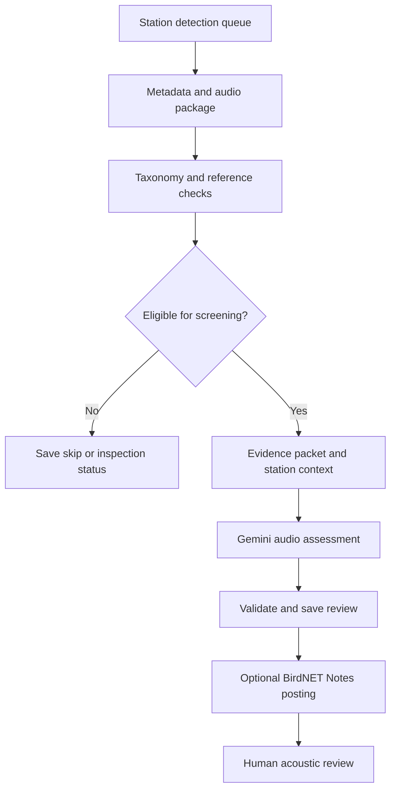
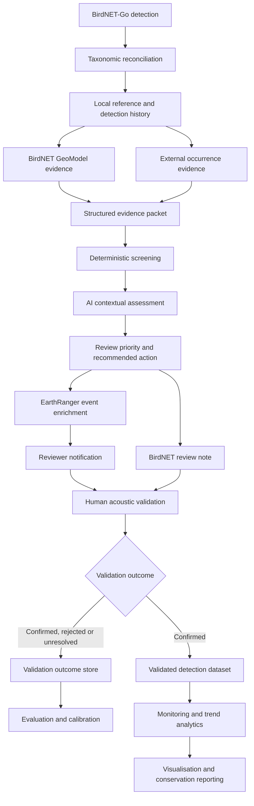

# BirdNET Detection Screening

An evidence-based, human-in-the-loop workflow for screening unusual BirdNET-Go detections on Cempedak and Nikoi and prioritising them for acoustic validation.

## Current implementation

The Python workflow has been tested locally across three stations. Once a batch is started, it discovers detections, retrieves metadata and audio, resolves taxonomy, checks an exported property species list and retained station history, sends eligible recordings to Gemini, validates the response, and posts an acoustic explanation to BirdNET Notes.

Final species verification remains human-controlled. Comment requests do not include verification or lock changes. Hosted continuous operation is not deployed yet.

| Component | Current behaviour | Remaining work |
|---|---|---|
| Detection scanner | Station-specific state, paginated metadata retrieval, deduplicated queues and recording-date backfill | Demonstrate complete coverage of earlier recordings |
| Preparation worker | Saves metadata and audio with provenance and checksum checks; bounded preparation attempts | Reduce downloads for recordings that will be skipped |
| Taxonomy and local reference | Resolves taxa and checks an exported property list | Synchronise with the current Flora and Fauna platform; strengthen name matching across history |
| Detection history | Tracks first retained detection IDs by scientific name | Recurrence, confidence summaries and distinct-candidate prioritisation |
| Evidence packet | Combines available taxonomy, register and recording context | Geographic occurrence evidence and richer historical features |
| Location | Includes configured station coordinates in new review packets | Explicit GeoModel evidence and independent geographic checks |
| Gemini | Analyses attached audio and returns a structured assessment | Evaluate results against human outcomes |
| BirdNET writeback | Posts the saved audio explanation as a comment | Reliable unattended authentication and note-content readback |
| Human review | Local review queue/report utility; final verification stays manual | Decision capture and agreed routing |
| EarthRanger | Mapping preview exists | Live event enrichment, record matching and notifications |
| Evaluation and analytics | Framework documented | Outcome store, calibration, validated trends and reporting |

## Stations

| Station ID | Property | BirdNET-Go URL | Configured latitude | Configured longitude |
|---|---|---|---:|---:|
| `CEMPEDAK_MAIN_KAMONG` | Cempedak | http://161.248.117.178:8080 | 0.845 | 104.704 |
| `CEMPEDAK_SOUTH_SIDE` | Cempedak | http://161.248.117.178:8081 | 0.843 | 104.703 |
| `NIKOI_MAIN` | Nikoi | http://161.248.117.22:8080 | 1.052 | 104.709 |

Each station has its own detection ID sequence, scanner state, audio directory, queue and review packages. Always identify a recording by station and detection ID together.

Coordinates describe the configured recording station, not the exact position of a calling bird. They currently provide context to Gemini; they do not establish species range or presence.

## Screening eligibility

The implemented policy allows review when a resolved taxon is absent from the exported property list, or when an already-listed taxon represents its first detection in the retained station history. Other established-species recordings are skipped. Missing or unresolved evidence requires inspection rather than an unsupported novelty decision.

This is not yet a strict property-wide "unlisted species only" filter. First retained station detections can qualify even when the species is already on the property list. The first retained ID is a history proxy, not proof of the first biological occurrence. History matching does not yet provide comprehensive synonym reconciliation.

Repeated recordings of an unlisted species can each qualify. Distinct-candidate prioritisation remains to be implemented so a batch is not dominated by one species.

The Flora and Fauna platform at https://species.bintanmpa.com/ remains the intended source of truth. Screening currently uses a local export, which can become stale. Absence from that export does not prove absence from the current platform or the island.

## Current workflow



BirdNET Notes contain a species-specific acoustic explanation. Operational metadata, register checks and attempt records remain in local review files. A posted note is an assessment, not a confirmed species record.

## Intended validation and reporting workflow

The original framework remains the longer-term design. Geographic evidence, operational EarthRanger integration and the outcome-driven reporting stages below are not yet complete.



Planned analytics include temporal trends, species occurrence patterns, station patterns and environmental context. Recording effort and uncertainty must be considered; detection activity alone does not establish population abundance.

## Setup and configuration

Create and activate a Python virtual environment, then install the repository dependencies:

```bat
python -m venv .venv
.venv\Scripts\activate
python -m pip install -r requirements.txt
```

Existing reference data and evidence-module configuration are also required. Installing packages alone does not supply the property lists or taxonomy resources.

Configure `.env` locally. Use decimal points for coordinates and the exact station IDs in variable names:

```dotenv
GEMINI_API_KEY=replace_with_authorised_key

BIRDNET_CEMPEDAK_MAIN_KAMONG_BASE_URL=http://161.248.117.178:8080
BIRDNET_CEMPEDAK_MAIN_KAMONG_SESSION_COOKIE=replace_with_session_value
BIRDNET_CEMPEDAK_MAIN_KAMONG_CSRF_TOKEN=replace_with_csrf_value
BIRDNET_CEMPEDAK_MAIN_KAMONG_LATITUDE=0.845
BIRDNET_CEMPEDAK_MAIN_KAMONG_LONGITUDE=104.704

BIRDNET_CEMPEDAK_SOUTH_SIDE_BASE_URL=http://161.248.117.178:8081
BIRDNET_CEMPEDAK_SOUTH_SIDE_SESSION_COOKIE=replace_with_session_value
BIRDNET_CEMPEDAK_SOUTH_SIDE_CSRF_TOKEN=replace_with_csrf_value
BIRDNET_CEMPEDAK_SOUTH_SIDE_LATITUDE=0.843
BIRDNET_CEMPEDAK_SOUTH_SIDE_LONGITUDE=104.703

BIRDNET_NIKOI_MAIN_BASE_URL=http://161.248.117.22:8080
BIRDNET_NIKOI_MAIN_SESSION_COOKIE=replace_with_session_value
BIRDNET_NIKOI_MAIN_CSRF_TOKEN=replace_with_csrf_value
BIRDNET_NIKOI_MAIN_LATITUDE=1.052
BIRDNET_NIKOI_MAIN_LONGITUDE=104.709
```

Use `--station-credentials` for posting with these station-specific keys. Older manual runners may still use the legacy `BIRDNET_BASE_URL`, `BIRDNET_SESSION_COOKIE` and `BIRDNET_CSRF_TOKEN`; check their usage before removing them.

## Running the workflow

Run commands from the repository root. Run only one watcher per station and avoid concurrent scanner, worker or posting processes against the same station's files.

### Initialise a new station

```bat
python src/automation/birdnet_detection_scanner.py --station NIKOI_MAIN --limit 200 --bootstrap
```

Bootstrap establishes a baseline without queuing existing recordings. Do not bootstrap an already-initialised station to resume work.

### Scan and prepare without Gemini or posting

```bat
python src/automation/birdnet_detection_watcher.py --station CEMPEDAK_MAIN_KAMONG --max-cycles 1 --max-items 20
```

### Review September and earlier recordings

```bat
python src/automation/birdnet_detection_watcher.py --station CEMPEDAK_MAIN_KAMONG --before-date 2026-10-01 --max-cycles 10 --max-items 20 --reviews-per-cycle 20 --run-gemini --model gemini-3.8-flash --post-notes --max-reviews 20 --station-credentials
```

Replace the station ID to run South or Nikoi. `--before-date` is exclusive midnight in station time (UTC+7): this example includes September and earlier recordings, not only September. Selection uses recording timestamps rather than assuming detection IDs indicate recording dates.

### Review recent recordings

```bat
python src/automation/birdnet_detection_watcher.py --station NIKOI_MAIN --recent-days 3 --max-cycles 10 --max-items 20 --reviews-per-cycle 20 --run-gemini --model gemini-3.8-flash --post-notes --max-reviews 20 --station-credentials
```

`--recent-days` uses a fixed cutoff captured at run start. Newest recordings are selected first. Older work is preserved.

### Review or post a prepared recording separately

```bat
python src/automation/birdnet_package_review.py --station NIKOI_MAIN --detection-id 10712
python src/automation/birdnet_package_review.py --station NIKOI_MAIN --detection-id 10712 --run-gemini --model gemini-3.8-flash
python src/automation/birdnet_post_review_note.py --station NIKOI_MAIN --detection-id 10712 --station-credentials
```

The first command prepares evidence without generation. Saved generation attempts prevent automatic repeat calls; failures can require inspection. Posting uses the saved review and makes no Gemini call.

### Limits and completion

- `--max-items`: maximum preparations per cycle.
- `--reviews-per-cycle`: maximum review-stage items inspected per cycle; skips can consume these slots.
- `--max-reviews`: completed review-item limit for the entire run, not a unique-species count.
- `--max-cycles`: scan-cycle limit.
- `--interval`: wait between cycles; total discovery-to-note latency also includes processing and backlog.

Reaching a review or cycle limit means the batch finished, not that the selected date range has been fully screened. Completion must account for skipped, pending, failed and blocked items as well as accepted posts.

The watcher polls BirdNET; it is not currently triggered by BirdNET notifications or a webhook. Omitting `--max-cycles` does not remove the review-item limit.

## Recovery and writeback interpretation

Queues, packages, generation-attempt records and writeback records are retained across restarts. Completed work is reused, and ambiguous outcomes are blocked rather than blindly retried.

A POST rejected with HTTP 401 is recorded as `authentication_rejected`. Refresh the selected station's credentials and resume: the saved Gemini result is retained. A 401 establishes authentication rejection; it does not by itself prove expiry.

`post_accepted_status_unchanged` means BirdNET accepted the POST and subsequent metadata checks found verification and lock statuses unchanged. It is not a note-text readback. The Notes tab can be checked to confirm visibility. Accepted writes with failed metadata readback require reconciliation; unknown write outcomes require inspection before repeat posting.

## Local validation snapshot: 9 October 2026

The supplied local result listing contains 86 accepted writebacks across all tests: 55 Main, 13 South and 18 Nikoi. Of these, 32 cover recordings dated 30 September: 24 Main, one South and seven Nikoi. Coordinates are present in 31 of those September review files; one reused an earlier assessment.

These counts are recording reviews, not new species counts or confirmation of species presence. They do not establish that the entire September-and-earlier backlog is complete. Nikoi detection 10712's note was also checked visually in BirdNET; its Gemini assessment remained uncertain.

## Requirements arising from review feedback

- Focus expensive screening on relevant new candidates and clarify property-wide versus station-history eligibility.
- Continue September and earlier recordings and measure coverage explicitly.
- Check the current Flora and Fauna list before manual additions. Include BirdNET URLs, acoustic-only provenance and identification uncertainty; do not describe records as visually observed.
- Keep false-positive decisions human-confirmed until the status-update process is agreed.
- Treat "ignore this species" as a separate decision affecting future detections, not as an individual-record rejection.
- Preserve the Flora and Fauna platform as the source of truth.

## Deployment discussion

The local workflow automates a started batch. It is not yet deployed as a continuously operated service, and cloud/Cloudflare deployment access has not yet been established.

Discuss the following with the infrastructure owner before selecting a deployment target:

1. A runtime capable of running the existing Python code, or an agreed adaptation to the existing platform.
2. Persistent storage and migration of station state, queues, reviews and attempt records so completed work is not repeated.
3. Secure configuration for Gemini and separate BirdNET station credentials.
4. Reliable unattended BirdNET authentication; current session-cookie failures remain a blocker.
5. Deployment permissions, logs, automatic restart, monitoring and operational ownership.
6. Network access to each station and external services, plus generation budget and processing limits.

Cloudflare account access alone is not a deployment design. Confirm the execution and storage approach with Ollie before assuming the current watcher can run unchanged there.

## Remaining roadmap

- [ ] Reliable unattended authentication and hosted operation.
- [ ] Distinct-candidate prioritisation and earlier-record completion tracking.
- [ ] Live Flora and Fauna reference synchronisation and reviewed manual additions.
- [ ] Richer detection-history features and explicit BirdNET GeoModel evidence.
- [ ] GBIF occurrence checks using station coordinates, with dates, source links and quality flags; eBird remains an optional later source.
- [ ] Broader deterministic screening and operational priority routing.
- [ ] EarthRanger enrichment and reviewer notifications.
- [ ] Human outcome capture: confirmed, rejected and unresolved.
- [ ] Evaluation against human outcomes and threshold calibration.
- [ ] Validated monitoring datasets, effort-aware trends and conservation reporting.

External occurrence checks must distinguish regional plausibility from island presence. No nearby records is insufficient evidence, not proof of absence. These geographic checks are planned, not currently implemented in the review workflow.

## Documentation

- [Framework](docs/framework.md)
- [Data sources](docs/data_sources.md)
- [Taxonomy strategy](docs/taxonomy_strategy.md)
- [Decision logic](docs/decision_logic.md)
- [Validation plan](docs/validation_plan.md)
- [EarthRanger mapping](docs/earthranger_event_mapping.md)

These documents describe the intended methodology; use the current implementation table above to distinguish operational features from plans.

## Data and credentials

`.env`, virtual environments, raw/reference/processed project data and generated outputs are excluded by `.gitignore`. Never commit credentials. Preserve operational state securely when moving to hosting; a clean code checkout does not contain the completed-review ledger.

## Evaluation principle

The intended evaluation compares BirdNET confidence alone, deterministic evidence-based screening, and screening with AI assistance using human-reviewed outcomes. AI value must be measured rather than assumed. Taxonomy establishes a reconciled name; audio and other evidence support a hypothesis; human review establishes the recorded validation outcome.
